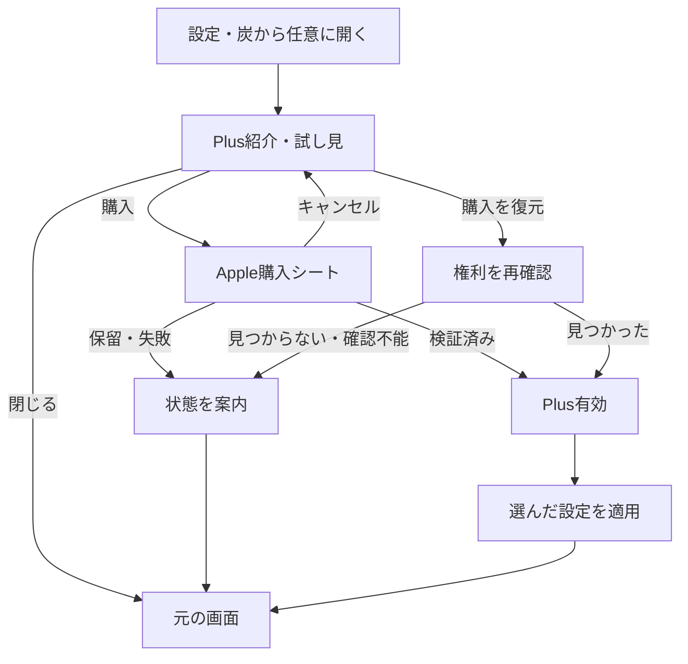

# Fire Task Plus 有料機能設計書

**リポジトリ対応版 1.1 / 2026年11月26日 / 対象リリース：v1.1**

入口は [README](README.md)、現行コード・先行PRとの対応と実装順は [IMPLEMENTATION_HANDOFF](IMPLEMENTATION_HANDOFF.md)。画面案は [PDF](SCREEN_DESIGN.pdf) と [一覧画像](SCREEN_OVERVIEW.png)。この追加は設計資料のみで、Plusの実装・商品登録・提出を行ったものではない。

## 0. 推奨する商品

**Fire Task Plus：好きな炎で、今日を終える。**

毎日のFireを自分好みに整え、終えたことをあとから眺められる、買い切りの追加機能にする。

| 項目 | 推奨案 |
| --- | --- |
| 商品 | Fire Task Plus、非消耗型の買い切り1商品 |
| 日本向け設計価格 | **800円**。App Store Connectで選択できる価格と表示を登録時に確認する |
| 柱1 | **好きな炎を選ぶ**：固定／お気に入りから選ぶ。既存の9種類を利用 |
| 柱2 | **自分の焚き火をつくる**：追加の情景2種類と、環境音の組み合わせを保存 |
| 柱3 | **積み重ねを眺める**：月別カレンダー、月のFire件数・炭合計、その日の記録への移動 |
| 無料で残すもの | 現在のタスク追加・分類・Fire・取消・炭記録・成長・称号・特殊炎の自動出現すべて |
| 購入前 | 炎、情景、音を実際に試せる。月別画面は明示したサンプルで確認できる |
| 案内 | 設定と「炭」の任意の操作から。自動の購入ポップアップは出さない |
| 今回入れないもの | 投げ銭、iCloud同期、ウィジェット、別アイコン、AI分析、日記、背景再生 |
| v1.0 | 依頼書どおり完全無料。Plusはv1.1から追加 |

### 設計の根拠と確認範囲

現状の根拠は、提供された「Fire Task 収益化設計 依頼書(Astra宛).md」と、`sunpotflower4460-cpu/sumples-fire` のコード確認。確認したmainは `bdd871ba174bc8cbc46798e508e0fc5ccabe7476`、提出準備PR [#122](https://github.com/sunpotflower4460-cpu/sumples-fire/pull/122) のheadは `1447dc4686beb291a86ea8e5c20a56eae5b60b28`。PR #122は確認時点で未マージであり、今回はマージしない。

依頼書のiPhone縦専用・表示名・提出資料・ネイティブ保存の前提は、先行する `release/app-store-finalize` に対応する。Plus実装はこの変更を失わない独立したv1.1ブランチで進める。現在の焚き火は「今日」、炭の履歴は「炭」にある。追加情景を眺める領域は「炭」に追加し、「今日」の無料の焚き火を移動・削除しない。詳細は引き継ぎ書を参照。

以下の追加機能・価格・優先順位は設計案であり、実装済みという意味ではない。実機・Appleアカウント・購入状態は未確認。画面PDFも依頼書に基づく画面案で、既存UIの再現ではない。モックアップの情報設計を既存のUIへ適用し、現在の画面全体を置き換えない。

Appleに関する事項は末尾の公式一次資料を2026年11月26日に確認した。価格の売れやすさや収益性を実測したわけではない。本文の「焚き火」は新規文言の統一案で、依頼書の「焼き火」表記は実装時に既存文字列と照合する。

## 1. 何を買う商品にするか

無料版の価値は「やりたくないことを、ひとつ終わらせられること」。Plusの価値は、繰り返すその瞬間を、自分の好きな体験にできること。

購入後の体験例：

1. 好きな「桜の火」を選ぶ。次にタスクを終えたとき、その炎で燃やせる。
2. 「星明かりの湖」を自分の焚き火に設定する。次に「炭」を開いたときも、同じ場所に戻れる。
3. 聴きたいときだけ火の音を再生し、夜の風を少し足す。
4. 月末にカレンダーを開く。「今月はこれも終えた」と、すでに残っている記録を眺め直す。

購入によってタスク達成を有利にしない。ポイント倍率、成長の早送り、連続日数の修復、称号の直接販売はしない。炎や背景の購入を何度も要求する商品分割も行わない。

「炎の色を変えるだけ」では、800円の価値が伝わりにくいというのが今回の設計判断。選ぶ楽しさ、戻りたくなる場所、積み重ねの実感をひとつの商品にまとめる。

## 2. 無料／Plusの振り分け

| 機能 | 無料 | Plus | 線引きの理由 |
| --- | --- | --- | --- |
| 名前だけでタスク追加 | 現状維持、件数の課金制限なし | 同じ | 中核機能 |
| 緊急度・重要度の分類 | 現状維持 | 同じ | タスク処理の土台 |
| Fireと元に戻す | 現状維持、回数制限なし | 同じ | 一番大切な儀式 |
| 炭ポイント・既存の炭記録 | 現行の保存・閲覧範囲を維持 | 同じ | 保存済み記録に新しい有料制限を設けない |
| 焚き火の6段階成長 | 現状維持 | 同じ条件 | 進みやすさを売らない |
| 連続日数・既存称号 | 現状維持 | 同じ条件 | 既存の達成を取り上げない |
| 特殊炎9種類の自動出現 | 現在の難易度・連続日数等による選択を維持 | 「おまかせ」で同じ体験 | 既存機能の有料化を避ける |
| 9種類から好きな炎を固定 | 試し見のみ | 設定して実際のFireに適用 | 毎回の終わり方を自分で選べる |
| お気に入りの炎から選ぶ | 試し見のみ | 選んだ集合を保存して適用 | 好みの範囲で変化を楽しめる |
| 既存の夜の焚き火 | そのまま利用 | 利用可能 | 無料の完成度を維持 |
| 星明かりの湖・雨あがりの森 | プレビューのみ | 設定を保存して「炭」に適用 | 自分の居場所にできる |
| 既存の着火・燃焼サウンド | 現状維持 | 同じ | 無料版を静かに劣化させない |
| 追加の環境音ミックス | 試聴のみ | 表示中の焚き火で利用・音量保存 | 任意にくつろぐ追加の体験 |
| 音オフ・省モーション | 無料 | 無料 | 快適さ・アクセシビリティ |
| 月別カレンダー・月合計 | サンプル画面 | 自分の記録を集計 | データを見やすく眺め直す追加ビュー |
| カレンダーの日付から記録へ移動 | 既存の記録閲覧は可能 | カレンダー経由でも移動可能 | 記録への新しい入口 |
| 購入の復元 | 無料で操作可能 | 無料で操作可能 | 購入権を戻す手続き |
| データ削除・データ管理 | 既存機能があれば同条件を維持 | 同じ | データの支配権を課金しない |
| iCloud同期 | v1.1対象外 | v1.1対象外 | 別の保存・復旧設計が必要 |
| ウィジェット・別アイコン | v1.1対象外 | v1.1対象外 | 商品の核を先に完成させる |

無料の履歴を30日だけにする、無料のタスクを10件までにする、特殊炎を更新後に出なくする、といった変更は採用しない。v1.0利用者もv1.1更新後にこれまでの機能をそのまま使える。

## 3. 有料機能A：好きな炎を選ぶ

### 3.1 使用できる炎

既存の `src/lib/fireBurnSpectacle.ts` に定義された9種類を共通カタログにする。表示名と実IDの対応は引き継ぎ書に記載する。

**炎／鬼火／黄金の炎／爆炎／龍の炎／桜の火／鉄の火／虚空の火／フェニックス**

新しい炎を制作しないとPlusを出せない構成にしない。購入済みなら、遭遇履歴や連続日数にかかわらず9種類すべてを演出として選べる。

### 3.2 三つのモード

| モード | 利用者 | 動作 |
| --- | --- | --- |
| おまかせ | 全員 | 現行の選択ロジックをそのまま使用 |
| この炎を使う | Plus | 選択した1種類を毎回使用 |
| お気に入りから | Plus | 選択した炎の中からFireごとに選択 |

お気に入りが2種類以上なら、直前の実Fireと同じ炎を除いて等確率で選ぶ。1種類なら固定と同じ。0種類は保存できず「1つ以上選んでください」と表示する。破損した保存値・削除されたIDを読み込んだ場合は「おまかせ」に戻す。

どの演出を使うかはFire開始時に一度だけ決める。画面再描画で抽選し直さない。プレビューは実Fireの直前履歴を変更しない。

### 3.3 購入前プレビュー

炎カードをタップすると、サンプルの紙片が燃える。画面に「試し見」と表示し、タスク・炭・称号・連続日数に影響させない。プレビュー内でタスク追加や実Fireはできない。

自動で9種類を同時に動かさない。選択中のプレビュー1つだけを描画し、それ以外は静止したサムネイルと名前にする。省モーション時は静止画か穏やかな切り替えを使う。

無料利用者が「この炎を使う」を押したときだけPlus紹介へ進む。購入前に選んでいた炎を画面内の下書きとして保持し、成功後に「この炎を設定」を押すと適用する。購入だけで意図せず別の炎へ変えない。

### 3.4 成果と演出を分ける

Fireの完了判定、ポイント算出、称号、成長は、既存ルールのまま計算する。選択したフェニックスだから高得点になる、実力・達成条件を満たした扱いになる、といった分岐を加えない。

確認したコードでは演出と報酬は分離されている。`useFireSeeds.ts` の `burnTask` が開始時に選んだ演出を映像とSEで共有し、炭は既存の難易度に基づいて算出する。Plusでもこの分離を維持し、映像と音が別の炎にならないようにする。今後、遭遇を条件にした称号を追加する場合も手動選択・試し見を自然遭遇として加算しない。

## 4. 有料機能B：自分の焚き火をつくる

### 4.1 三つの情景

| 情景 | 利用 | 画面の方向性 | 音の初期プリセット |
| --- | --- | --- | --- |
| 夜の焚き火 | 無料／Plus | 既存の見た目を維持 | 追加環境音は停止 |
| 星明かりの湖 | Plus | 深い紺、星、低い地平線と水面。文字の背後は静かに | 火35%、夜の風15%、雨だれ0% |
| 雨あがりの森 | Plus | 青灰色の森のシルエット、濡れた地面、暖かい火 | 火35%、雨だれ20%、夜の風0% |

プリセットの数値は初期音量の提案値で、実際の音量感は実機で調整する。プリセットを選んでも音は自動再生しない。

追加情景を眺める領域を「炭」画面へ新設する。現在の「今日」の `FireCampfire` と、無料の `AshLegacy` の履歴は維持する。無料の既定情景も追加領域で利用でき、Plusだけが2つの追加情景を保存・適用できる。「今日」の4象限の色、緊急度の判断、タスクの読みやすさは維持する。背景を変えるだけで成長段階が上がる仕様にはしない。

既存の焚き火描画と6段階成長を共通部品として使い、情景を背景レイヤーで差し替える。2情景×6段階分の独立した成長演出を新規制作する計画にはしない。

### 4.2 音の機能

追加音は「火の音」「雨だれ」「夜の風」の3レイヤー。各音量を0〜100%で調整し、組み合わせを端末に1セット保存する。最初は合成音を使い、外部配信・外部素材・新しいSDKを必要としない。合成音で継ぎ目や質感が十分にならない場合は、音を雑に公開せず、情景の数や発売時期を調整する。

初回も次回起動時も停止状態で開く。音量と情景は保存するが、再生状態は保存しない。利用者が「音を再生」を押したときだけ再生する。

v1.1では「炭」とカスタマイズ画面を表示している間だけ再生する。「今日」へ移る、購入画面へ移る、アプリを離れる、画面をロックする、電話等で中断されると停止する。復帰時の勝手な再開はしない。バックグラウンド再生、ロック中の連続再生、睡眠タイマーは付けない。

既存のFireサウンド設定はそのまま残し、追加環境音と別に扱う。音を止める操作は無料・購入済みにかかわらず使える。iPhoneの消音設定、ほかのアプリの音楽再生との共存を確認し、他の音声を意図せず中断しない。

### 4.3 購入前の試し方

情景と音量は、プレビューの間だけ変更できる。退出すると現在の焚き火へ戻る。環境音は本人が再生を押すまで鳴らさない。試聴回数をカウントする仕組みや、期限付きの無料体験は付けない。

Plusが必要なのは、選んだ情景と音を「自分の焚き火」として保存し、通常の「炭」画面で使うこと。無料プレビューには実際の炭記録・焚き火成長を持ち込まず、独立したサンプルを使う。

## 5. 有料機能C：炭の月別ふりかえり

### 5.1 画面内容

「炭」にある「月ごとに見る」から開く。表示するのは以下に絞る。

- 月の切り替え。最初は今月、未来の月には進めない。
- 月内で完了し、取消されていないFireの件数。
- 同じ記録から集計した炭ポイントの合計。
- カレンダー上の小さな火の印と、その日のFire件数。
- 日付を押したときの、その日の完了タスク一覧。

日付は「26日、3件、炭18」のようにVoiceOverでも把握できる。Fireした日だけに控えめな印を付け、何もしていない日は通常の日付表示にする。空白に失敗色を付けたり、前月より少ないことを警告したりしない。

v1.1には効率スコア、他人との比較、AIによる性格分析、連続記入、日記入力は入れない。既存データを眺めるだけで成立する画面にする。

### 5.2 無料の履歴との関係

保存済みの炭記録は、現行の方法で引き続き閲覧できるようにする。Plus追加を理由に閲覧期間や件数を制限しない。Plusはカレンダーと集計という追加の見せ方を提供する。購入してからの記録だけを集計するのではなく、**端末に残っている確かな過去データも対象**にする。

無料利用者向けプレビューには「表示例」と明記した架空のデータを使用する。サンプル値を本人の実績と混同させない。購入を迷う人に、実際の履歴が封じられたような表示を見せない。

### 5.3 保存データの確認と移行

確認した現行の `FireSeed` は `title`、`burned`、`burnedAt`、`ashPoints` を保持している。独立した完了ログはない。まず既存の燃焼済みseedを正として月別表示を導出し、同じ完了を別のログへ重複保存することを必須にしない。

有効な `burnedAt` のある既存記録は過去月も集計する。日時のない記録を `createdAt` や `updatedAt` から推測して月へ割り当てない。新しい現地日付・タイムゾーンの保存を加える場合は、購入状態に関係なく全員の完了時に記録し、後日Plusを購入した人も保存済みデータを使えるようにする。

古い合計ポイントしかない場合、過去の日別分布を推測しない。旧合計は既存表示に維持し、新しい月別画面には「月ごとの記録は〇年〇月〇日から」と表示する。購入画面にも「端末に残っている記録を表示します」と添える。

集計仕様：

- 現行のseedを完了記録の正とする。既存のID・表示名・完了日時・付与した炭・燃焼状態を使い、完了時の現地日付・タイムゾーン情報等を追加する場合は `normalizeSeed` も対応させる。新フィールドを再読込で落とさない。独立ログを採用する場合は重複加算・Undo・削除と保存失敗への整合を別途設計し、その必要性を説明する。
- 日付のまとまりは完了時の現地日付を使い、旅行やタイムゾーン変更で過去の実績を別日に移さない。旧記録の日時から変換する場合の基準は移行時に一度決めて保持する。
- 月の件数は有効な完了イベント数。ポイントは当時実際に付与した値を合計し、現在の算式で再計算しない。
- FireとUndoは、完了イベント、炭、成長、各カレンダー集計に整合して反映する。更新途中の失敗から復旧できる保存単位にする。
- 同じ完了IDの再処理で二重加算しない。取り消したあと本当に再度Fireした場合は新しい完了として1件だけ数える。
- タスク名の後日の編集・削除が履歴に与える影響は既存仕様に合わせる。ユーザーが履歴自体を消す操作をした場合、隠れた集計用コピーに名前を残さない。
- 記録が0件なら「この月の記録はまだありません」。空欄と0件を区別し、保存開始前の月は「記録開始前」と表示する。

## 6. 価格・商品構成

### 主案：800円の買い切り1商品

根拠：日々使う炎の選択、居場所のカスタマイズ、過去を眺める機能の3つを、説明しやすい一度の購入にまとめられるため。

これは市場検証済みの最適価格ではなく、依頼書の480〜960円という範囲内での開始案。商品登録時に日本を基準ストアとして選択可能な価格を確認する。実際のアプリはハードコードした800円ではなく、StoreKitが返す `Product.displayPrice` を表示する。[S1][S2]

### 代替案：600円で機能を絞って開始

炎選択と焚き火カスタマイズを先に届け、月別ふりかえりの実装を見送る場合の案。未完成のふりかえりは販売画面や商品説明に含めない。最初から機能をそろえられるなら主案の800円を推奨する。

### 商品数と応援

v1.1はPlusのみ。炎ごとの販売、情景ごとの販売、上位のPro、投げ銭は追加しない。購入の判断を1つにし、何が解放されるかを明確にする。投げ銭はPlus購入後に応援したいという要望が確認できた段階で別途判断する。

「今だけ」「残り〇時間」「元の価格から〇%引き」「一生すべての新機能が無料」は使わない。今回販売する3機能の利用権に更新料金はない、という範囲を説明する。未設計の将来機能まで約束しない。

### 手数料の扱い

AppleのSmall Business Programには申請・承認と適用開始がある。依頼書の15%は、加入状態が確認できるまで試算上の仮定とする。[S3]

単純計算なら800円×85%=680円だが、税金・返金・調整を反映した確定入金額ではない。価格決定を「必ずこの額が残る」という前提に置かない。

## 7. 画面構成と導線

既存の「今日／炭／設定」の3タブを維持する。課金用の4つ目のタブは増やさない。

| 画面ID | 画面 | 主な要素 | 開き方 |
| --- | --- | --- | --- |
| S01 | 設定 | Fireサウンド、Plusカード、購入を復元、既存リンク | 設定タブ |
| S02 | Plus紹介 | 見出し、3特典、試し見、価格、購入、復元、閉じる | 設定／任意のPlus操作 |
| S03 | 炎を選ぶ | 9種類、3モード、試し見、設定ボタン | Plus紹介／購入後の設定 |
| S04 | 焚き火を整える | 情景3種類、音の再生、各音量、保存 | 「炭」の情景変更／設定 |
| S05 | 月別ふりかえり | 月、件数、炭、カレンダー、その日の記録 | 「炭」の「月ごとに見る」 |
| S06 | 購入後 | お礼、選んでいた特典の設定、閉じる | 購入・復元成功時 |
| S07 | 購入状態の表示 | 失敗、承認待ち、確認不能、復元結果 | S02内のインライン表示 |

### S02：Plus紹介の配置

上から、閉じる、商品名、見出し、選択中の炎のプレビュー、短い説明、3つの特典、購入エリア、復元と補足を配置する。購入価格は3つの特典と同じ画面で確認できるようにする。

購入エリアは、1行目が「{価格}でPlusを購入」、2行目が「一度の購入。月額料金はかかりません。」。その下に「購入を復元」「あとで」を置く。アプリ側の閉じる操作は常に可能にする。Appleの購入シートが開いている間はシステムの操作に従う。

狭い画面や文字拡大時は全体をスクロール可能にする。固定の購入ボタンで本文や復元を覆わない。長い価格文字列でも省略して金額が読めなくなる構成にしない。

### S01：購入済みの設定

Plusの紹介カードを「Fire Task Plus／購入済み」に変える。その下に「炎を選ぶ」「焚き火を整える」「月別ふりかえり」を置く。「購入を復元」は残す。

購入済みの人に購入CTAやPlusの案内バッジを出し続けない。購入状態の確認が一時的に終わらないときも「今日」とFireは使用可能にする。

### 画面フロー

保留が後から成功した場合は、アプリを使用中でも購入権を反映する。ただしFire演出やUndoを遮る成功モーダルは開かず、設定画面の状態更新等で知らせる。

## 8. Plusに出会わせる場面と頻度

| 場面 | v1.1での表示 | 頻度・動作 |
| --- | --- | --- |
| 設定 | 「Fire Task Plus」のカード | 未購入なら常設1件。赤いバッジや点滅は付けない |
| 「炭」の焚き火 | 「焚き火を整える」 | 本人が押したときにプレビューへ |
| 「炭」の記録 | 「月ごとに見る Plus」 | 本人が押したときに表示例と内容を説明 |
| 炎の試し見 | 「この炎を使う」 | 未購入で押したときだけPlus紹介へ |
| Fire直前・演出中・Undo表示中 | 何も出さない | 0回 |
| 特殊炎が出た直後 | 自動案内を出さない | 0回 |
| 焚き火が成長した直後 | 成長体験のみ | 購入案内は0回 |
| 起動時、何日ぶりの再訪 | 自動ポップアップを出さない | 0回 |
| Appleの購入をキャンセル | 直前のPlus紹介へ戻る | エラーや再購入の催促を出さない |
| Plus紹介を閉じる | 元の通常画面へ戻る | 自動再表示しない |

v1.1では、案内回数のための解析SDKや遠隔設定は不要。利用者が自分で覗いて、良ければ選べる導線で始める。購入率を上げるためにFireの余韻を割り込ませる変更はしない。

## 9. 日本語文言一式

### 9.1 Plus紹介・購入後

| キー | 文言 |
| --- | --- |
| plus.name | Fire Task Plus |
| plus.headline | 好きな炎で、今日を終える。 |
| plus.description | 炎を選び、焚き火を整え、終えたことを眺める。いつものFireを、あなた好みに。 |
| plus.benefit.flame.title | 好きな炎を選ぶ |
| plus.benefit.flame.body | 9種類から、いつもの炎を。お気に入りだけで楽しむこともできます。 |
| plus.benefit.scene.title | 自分の焚き火をつくる |
| plus.benefit.scene.body | 星明かりの湖や、雨あがりの森へ。景色と音を、好きな組み合わせに。 |
| plus.benefit.history.title | 積み重ねを眺める |
| plus.benefit.history.body | 月ごとのカレンダーで、終えたことと炭の記録をふりかえれます。 |
| plus.preview | 試してみる |
| plus.purchase | {displayPrice}でPlusを購入 |
| plus.one_time | 一度の購入。月額料金はかかりません。 |
| plus.free_remains | タスクの追加・Fire・炭の記録は、これまでどおり無料です。 |
| plus.restore | 購入を復元 |
| plus.later | あとで |
| common.close | 閉じる |
| plus.purchased | 購入済み |
| plus.thanks | Plusをご購入いただき、ありがとうございます。 |
| plus.next | さっそく、自分の焚き火を整えてみませんか。 |
| plus.set_selected | 選んだ設定を使う |
| plus.finish | 今は閉じる |

### 9.2 カスタマイズ・記録

| キー | 文言 |
| --- | --- |
| flame.title | 炎を選ぶ |
| flame.auto | おまかせ |
| flame.fixed | この炎を使う |
| flame.favorites | お気に入りから |
| flame.favorites.empty | 1つ以上選んでください。 |
| preview.label | 試し見 |
| preview.no_record | 試し見では、タスクや炭の記録は変わりません。 |
| preview.plus_save | Plusで、この設定を使えます。 |
| scene.title | 焚き火を整える |
| scene.save | この焚き火にする |
| sound.play | 音を再生 |
| sound.stop | 音を止める |
| sound.foreground | この画面を見ている間だけ再生します。 |
| history.title | 月別ふりかえり |
| history.count | Fireした件数 |
| history.charcoal | 炭の合計 |
| history.empty | この月の記録はまだありません。 |
| history.start | 月ごとの記録は{date}から表示されます。 |
| history.sample | 表示例 |
| history.available | 端末に残っている記録を表示します。 |
| restore.scope | 購入の復元はPlusの利用権のみが対象です。端末内のタスク記録は復元されません。 |

### 9.3 購入・復元の状態

| キー | 文言 |
| --- | --- |
| store.loading_price | 価格を確認しています… |
| store.price_unavailable | 現在、購入情報を取得できません。時間をおいてお試しください。 |
| store.purchasing | 購入を確認しています… |
| store.pending | 購入手続きの完了を待っています。確認でき次第、Plusが使えるようになります。 |
| store.failed | 購入を完了できませんでした。時間をおいて、もう一度お試しください。 |
| store.unverified | 購入情報を確認できませんでした。購入の復元をお試しください。 |
| store.retry | もう一度試す |
| store.restoring | 購入履歴を確認しています… |
| store.restored | Plusの購入を復元しました。 |
| store.nothing_to_restore | Plusの購入が見つかりませんでした。購入時のApple Accountをご確認ください。 |
| store.restore_unavailable | 今は購入履歴を確認できません。通信状態を確認して、もう一度お試しください。 |
| store.restricted | この端末では購入できません。スクリーンタイムなどの購入設定をご確認ください。 |
| store.revoked | Plusの購入が取り消されたため、追加機能の利用を停止しました。タスクと炭の記録は残っています。 |

キャンセル時は原則としてメッセージ自体を出さず、元の画面に戻す。確認不能を未購入・二重購入の勧誘に変換しない。購入済みでオフラインの人には、毎回オフライン警告を見せず普段どおり使える範囲を提供する。

### 9.4 App Store Connect登録文言

| 項目 | 提案値 |
| --- | --- |
| 商品タイプ | 非消耗型 |
| 表示名 | Fire Task Plus |
| 説明 | 好きな炎、焚き火の景色と音、炭の月別ふりかえりを買い切りで。 |
| 管理用参照名 | Fire Task Plus Lifetime Unlock |
| Product ID | `com.sunpotflower.sumplesfire.plus` を登録候補とする。既存商品との重複・登録状況は未確認 |

表示名は14文字、説明は30文字。Appleの専用ヘルプに記載された表示名2〜30文字、説明45文字以下に収めている。[S4]

Family Sharingの提供はv1.1の販売上の約束に含めない。同じ購入用Apple Accountでの購入権復元と、家族への共有、タスクデータの共有はそれぞれ別の機能として扱う。

### 9.5 審査メモの原稿

> Fire Task Plus is a non-consumable in-app purchase. It unlocks manual selection of nine existing fire effects, two additional campfire scenes with foreground ambient sound controls, and a monthly calendar view of locally stored completion records. Core task creation, task completion, undo, charcoal records, existing progression, and automatic fire effects remain free. Open Settings > Fire Task Plus to view the purchase screen. Restore Purchases is available from Settings and the Plus screen. Previews do not alter tasks or rewards. No app account is required. Restoring the purchase restores the Plus entitlement only; it does not restore locally stored task data.

実際に出荷する機能と入口、登録済みProduct ID、審査用スクリーンショットを照合してから提出する。この原稿は提出済みではない。

## 10. 購入・復元の動作仕様

### 10.1 判定の分離

「購入権があるか」と「今、価格を取得できるか」を分ける。価格取得が失敗しても既購入のPlusを無効にしない。React側の保存値 `isPlus=true` だけを購入済みの根拠にしない。

StoreKit 2を扱うネイティブ層で検証し、Reactには必要最小限の状態と表示用価格を渡す。起動時の `Transaction.currentEntitlements` と、アプリ外・後日完了も受ける `Transaction.updates` を使用する。購入成功も検証済み取引のみ反映し、機能提供後に `finish()` する。[S5][S6]

### 10.2 状態表

| 状態 | 購入ボタン | Plus機能 | 表示・次の操作 |
| --- | --- | --- | --- |
| 未購入・価格取得済み | 実価格で有効 | 試し見のみ | 購入／閉じる／復元 |
| 起動直後・購入権確認中 | 判定前に購入を促さない | 確認中に購入済み表示を消さない | 「今日」とFireは使用可能 |
| 価格取得中 | 無効・読み込み表示 | 既存の権利判定に従う | 通常のタスク利用は可能 |
| 価格取得失敗・商品未配信 | 無効 | 既存の権利判定に従う | 再試行／閉じる |
| 購入処理中 | 二重タップ不可 | 成功するまで新規解放しない | システム購入シート |
| キャンセル | 元の状態へ | 変更なし | エラーを出さず戻る |
| 承認待ち・pending | 重複購入を開始しない | 既存の権利は維持 | 閉じられる。updatesを監視 |
| 検証済み成功 | 購入済みに置換 | 全特典を解放 | 選択していた設定を案内 |
| 検証失敗・unverified | 再購入を誘導しない | この結果では新規解放しない | 復元／再確認／閉じる |
| その他の購入失敗 | 再試行可能 | 変更なし | 簡潔なエラー |
| 復元中 | 重複操作不可 | 確認中に既存権利を消さない | 閉じても無料利用は可能 |
| 復元成功 | 購入済み | 解放 | 成功を表示 |
| 復元完了・権利なし | 未購入状態 | 試し見のみ | 購入用Apple Account確認案内 |
| 復元通信失敗 | 再試行 | 確認済みの権利を維持 | 「見つからない」とは言わない |
| 既購入・オフライン | 購入済み | 端末の検証済み情報で利用 | 通信失敗だけでロックしない |
| 新端末・権利情報なし・オフライン | 新規購入不可 | 新規解放しない | 接続後の復元を案内 |
| 検証された返金・取消 | 未購入へ | 追加機能を停止 | 無料機能と全記録を維持 |
| 購入制限あり | 無効 | 既存の権利は別に判定 | 端末の購入設定を案内 |

保留は承認待ちや追加認証を含み得るため、表示文言は「購入手続きの完了を待っています」とする。保留中の購入連打は防ぐが、端末に保存した保留フラグだけで購入を永久に禁止しない。「購入状況を確認」からStoreKitの権利を再確認できるようにし、起動し直した場合も最新の状態を確認する。取引の確定を観測するまでは解放せず、本人がシステムの購入操作を改めて行う導線は残す。

`AppStore.sync()` は、本人が「購入を復元」を押したときに呼び、その後に権利を再確認する。起動のたびに認証を要求しない。[S7]

オフラインでも端末にある検証可能な取引情報を利用できる。ただし、新端末で情報が一度も取得されていない場合や、オフライン中に発生した返金の即時反映は保証しない。再接続後に更新を受ける。[S8][S9]

### 10.3 返金・取消時

確定した取消を受けたら、通常の炎は「おまかせ」、情景は無料の夜の焚き火に戻し、追加環境音は停止する。タスク、炭、完了記録、成長は削除しない。

好みの設定値は端末内に保持してよいが、利用権が戻るまでは有料機能に適用しない。再購入・復元後は本人が設定を適用できるようにする。取消を脅す通知や全画面表示をFire中に出さない。

### 10.4 復元の範囲

購入権とタスク保存は独立している。「購入を復元」はPlusの利用権を確認する機能。iCloud同期を設けないv1.1では、機種変更・再インストールに伴うタスクや炭記録の復元をこの機能で約束しない。OSによる端末バックアップの挙動も、本アプリ独自の復旧保証として説明しない。

## 11. 実装の責務と保存

具体的なファイル名や既存状態管理を決め打ちせず、次の責務を実装へ落とし込む。

| 責務 | 担当内容 |
| --- | --- |
| Native Purchase Service | 商品取得、StoreKit検証、購入、復元、updates、失効反映 |
| Plus Entitlement | 未購入／確認中／検証済み購入／取消等の状態をUIに提供 |
| Fire Style Resolver | おまかせ／固定／お気に入りから、実Fireの演出IDを1つ決定 |
| Campfire Preferences | 情景と音量の端末保存、購入状態を考慮した適用 |
| Completion Record | 実際の完了・取消の記録。購入状態に関係なく整合性を維持 |
| Monthly Summary | 同じ記録を月・日で集計。ポイントを独自に作らない |
| Preview Session | サンプルの演出・音を隔離。実データ・実績・権利を書き換えない |

設定の最小項目：スキーマ版、炎モード、固定炎ID、お気に入りID集合、直前の実Fireで表示した炎、情景ID、環境音の各音量。再生中フラグは永続化しない。

先行PR #122の `getAppStorageDriver()` と、初回描画前の `initializeAppStorage()` を利用する。新しい永続キーは `DURABLE_STORAGE_KEYS` に追加する。`NativePreferencesDriver` の同期的な受付成功や `flush()` の完了は、ネイティブ書込の成功そのものを意味しない。保存失敗の通知・状態・再試行を扱い、失敗後に「保存しました」と確定表示しない。購入権の根拠は設定値ではなくStoreKitの検証結果とする。

Plusによる「見せ方の設定」を変えることで、進行中のタスクを消したり、保存形式全体を初期化したりしない。購入・復元の途中でアプリが終了しても、起動後の権利確認で再び正しい表示にできるようにする。

## 12. プライバシーとアクセシビリティ

### プライバシー

タスク、炭、環境音の好み、月別集計は端末内で処理する。広告・追跡・解析SDK、購入管理SaaS、外部音源配信、購入情報の自社サーバー送信は追加しない。

Appleの定義では、端末内だけで処理され外部送信されないデータは「収集」に該当しない。Appleの決済を追加するだけで、直ちに「データ収集なし」が成立しなくなるという意味でもない。一方で、Appleのサービスから開発者が取得するデータや組み込むSDKも含め、実態に合わせて申告を確認する必要がある。[S10]

今回の設計は「データ収集なし」を維持できる構成を目指す。最終的な表示を、実装を見ずに保証するものではない。購入記録を端末から開発者へ送って購入率を測る仕組みは追加しない。

### アクセシビリティ

- 依頼書のWCAG AA方針を維持する。通常文字のコントラストは4.5:1以上を目標とし、大きな文字等の適用条件も確認する。[S11]
- 本文は原則16px相当、補助は14px相当を基準にし、12px未満にしない。購入価格・復元・注意事項を小さく隠さない。
- タップ領域は44pt相当を設計基準とする。文字拡大時は縮小ではなく改行・縦方向の伸長で対応する。
- 炎の色だけで選択状態を表さず、チェックと名称を付ける。
- 省モーションは購入前後で共通に適用する。爆炎・フェニックスの明滅を有料演出の見せ場として強制しない。
- VoiceOverで選択中・未選択・Plus対象・価格・購入状態を読み上げられるようにする。
- 購入画面の閉じる、戻る、購入を復元は文字拡大と縦画面で到達可能にする。
- 音を止める操作は常に分かりやすい場所に置く。

## 13. v1.1の実装範囲と優先順位

工数はコードの読取確認に基づく相対評価で、実装・実機検証前のもの。小=局所UIと保存、中=複数状態や既存処理との接続、大=ネイティブや移行を含む確認が必要、を意味する。日数の見積りではない。

| 優先度 | 作業 | 工数 | 完了条件 |
| --- | --- | --- | --- |
| P0 | 現行の炎選択・報酬・完了保存の確認 | 中 | 無料を維持する範囲と移行方法が分かる |
| P0 | 非消耗型商品とStoreKit 2連携 | 大 | 購入・復元・保留・取消・オフラインを実機で扱える |
| P0 | Plus画面、状態表示、購入済み設定 | 中 | 何をいくらで買うか明確、閉じる・復元が使える |
| P0 | 炎9種のプレビューと3モード | 中 | 実Fireへ反映、ポイントと実績に影響なし |
| P0 | 情景2種と保存 | 中 | 既存の成長・読みやすさを保ち、次回も反映 |
| P0 | 環境音3レイヤーと停止処理 | 中 | 無断再生・バックグラウンド残留・音割れなし |
| P0 | 完了記録の整合と月別ふりかえり | 中〜大 | Undo・旧データ・日付・合計が正確 |
| P0 | 旧利用者の無料機能維持とデータ移行 | 中 | 更新後に過去記録も機能も失わない |
| P0 | アクセシビリティ・省モーション | 中 | 無料とPlusの両方で操作可能 |
| P1 | 案内の短文、試し見への入口、審査資料 | 小〜中 | UIと商品説明と審査メモの内容が一致 |

主案の800円で出す場合、3本の柱はすべてv1.1の出荷対象とする。月別記録の前提が成立しない場合に、見せかけのグラフで埋めない。範囲を変更して代替案に切り替えるか、正確な記録を開始できてから出す。

### v1.1に入れない機能

| 機能 | 見送る理由 | 次に検討する条件 |
| --- | --- | --- |
| ウィジェット | ネイティブ拡張と共有データの設計が必要。現在の3画面の完成を優先 | アプリを開かずに確認したい需要が具体的にある |
| iCloud同期 | 競合、取消、削除、復旧、複数端末の整合が必要 | 機種変更・複数端末の利用が主要な課題になった |
| アプリアイコン変更 | 好みに合う特典だが、炎と情景の完成度に比べて優先度が低い | 3本柱が安定したあと |
| 一言日記・月の記念カード | 新しい入力・保存・編集・削除が必要 | 見るだけのふりかえりでは物足りないという反応がある |
| 背景再生・睡眠タイマー | タスク終了のアプリから音アプリへ広がる | 焚き火の音を長時間聴きたい需要がある |
| AI分析・生成タスク | 外部送信と継続費用が、現方針に合わない | 別の事業・プライバシー設計を検討する場合 |
| 投げ銭 | 最初の購入判断が増える | Plus以外にも応援したいという要望がある |

これらは販売予定の約束ではない。Plus紹介画面に「今後対応」と並べない。

## 14. 検証と出荷の判断

### 14.1 実装時の必須シナリオ

1. 無料のままタスク追加→Fire→炭→Undoが成立し、課金画面が割り込まない。
2. v1.0から更新しても、特殊炎の自動出現・成長・記録が失われない。
3. 全炎の試し見でポイント、連続日数、称号、記録が一切増えない。
4. 同じ条件のタスクで、無料・固定炎・お気に入りのポイントが一致する。
5. 固定した炎とお気に入り集合が再起動後も保持される。
6. 情景変更後も6段階成長が表示でき、今日の象限色に影響しない。
7. 音は初期停止、明示再生、画面退出・バックグラウンド・中断で停止する。
8. 実購入成功・キャンセル・保留後成功・検証失敗・二重タップを正しく扱う。
9. 再インストール／同じ購入用Apple Accountの別端末で購入権を復元できる。タスク復旧と混同しない。
10. 購入済みで価格取得に失敗しても、端末に検証可能な購入情報があるなら利用を継続できる。
11. 返金・取消の確認後、追加機能だけが停止し、タスクと炭は残る。
12. 月末・日付またぎ・タイムゾーン変更・Undoで日別と月別と累計が仕様どおり整合する。
13. 古い記録に不足情報があるとき、存在しない過去データを補完しない。
14. 文字拡大・VoiceOver・省モーションで購入、閉じる、復元、選択ができる。
15. 通信先・SDK・プライバシー申告に、意図しない追加がない。

購入はローカルStoreKitテストで状態を確認したうえで、登録した商品を使う実機Sandboxで検証する。今回の納品には購入の接続や実機検証は含まれない。

### 14.2 v1.0からPlusを出す判断

星評価や継続率だけを発売条件にしない。以下の3点を先に満たす。

- 中核の追加・Fire・Undo・記録保存に未解決の重大不具合がない。
- 少人数の利用観察で、無料体験の意味と基本操作が伝わる。
- Plusの画面を見た人が「何が無料で、何を買うのか」を自分の言葉で説明できる。

実務上の仮の目安は、5人程度の利用観察で4人以上が購入対象と一度の支払いを説明でき、既存の無料機能が消えると誤解する人がいないこと。これは市場の購入率を推定する統計ではなく、説明の分かりやすさを改善するための基準。

App Store Connectの継続率は、診断・利用状況の共有に同意した利用者に基づき、少数では表示されない場合もある。見る場合も、全利用者の継続率と同一視しない。[S12] 「データ収集なし」の方針と、開発者が取得する分析データの扱いを先に照合する。

独自の画面表示回数やタップを外へ送らないため、「Plus画面を見た人のうち何%が買ったか」はこの設計では計測できない。把握していない購入率を報告しない。販売件数、任意の感想、問い合わせを別々の証拠として扱い、売れない場合は価格変更の前にプレビューと価値の伝わり方を確認する。

## 15. 実装担当への引き継ぎ

### 着手時に確認する4点

1. PR #122の最新headと統合状況。Bundle IDは `com.sunpotflower.sumplesfire` を維持し、release側のCapacitor・保存・iOS専用ビルドの構成を引き継ぐ。
2. 炎選択と音の共有、既存の報酬分離、Undoと記録保存の単位を着手時のコードで再確認する。
3. 保存済みseedの `burnedAt`、日付不明の記録、追加フィールドの正規化、ネイティブ保存失敗の扱いを確認する。
4. App Store Connectの商品登録、Paid Apps契約、Small Business Programの承認・適用状態。今回のコード確認からはこれらの状態を断定しない。

### 推奨する進め方

最初に現行の無料機能と保存構造を確認し、完了・取消の整合を保つ。次に炎・情景・月別ビューを独立したプレビューで実装し、StoreKitの購入状態を接続する。最後に実機で購入・復元・音・省モーション・旧データ移行を確認する。

買い切り画面を先に作り、解放する中身を後回しにしない。実際に確認できる特典だけを商品説明に載せる。

### 今回の判断状況

| 項目 | 状態 |
| --- | --- |
| 名称 | Fire Task Plusを推奨 |
| 価格 | 800円を推奨、登録価格未確定 |
| 特典 | 炎選択・焚き火カスタマイズ・月別ふりかえりを推奨 |
| 投げ銭 | v1.1は入れない提案 |
| iCloud同期 | v1.1は入れない提案 |
| 納品形式 | リポジトリ内の詳細設計・実装引き継ぎMarkdown＋画面モックアップPDF＋一覧画像 |
| 実装・商品登録 | 未実施。設計後の別工程 |
| 納期 | 実装担当とコード確認後に決める。日数は断定しない |
| 小規模事業者プログラム | 申請・承認状況未確認 |

## 16. 出典

現状仕様：ユーザー提供「Fire Task 収益化設計 依頼書(Astra宛).md」（2026年11月26日）。本文の提案と現状を区別して記載した。

コード確認：main `bdd871ba174bc8cbc46798e508e0fc5ccabe7476` とPR #122 head `1447dc4686beb291a86ea8e5c20a56eae5b60b28`。確認したパスと実装上の注意は [IMPLEMENTATION_HANDOFF.md](IMPLEMENTATION_HANDOFF.md) にまとめた。

- **[S1] Apple — Set a price for an In-App Purchase**：基準ストア、価格設定、Paid Apps Agreement。https://developer.apple.com/help/app-store-connect/manage-in-app-purchases/set-a-price-for-an-in-app-purchase/
- **[S2] Apple — Product.displayPrice**：ストアに応じた表示用価格。https://developer.apple.com/documentation/storekit/product/displayprice
- **[S3] Apple — App Store Small Business Program**：15%の制度、申請、適用時期。https://developer.apple.com/app-store/small-business-program/
- **[S4] Apple — アプリ内購入の情報**：表示名と説明の長さ、審査資料。https://developer.apple.com/jp/help/app-store-connect/reference/in-app-purchases-and-subscriptions/in-app-purchase-information/
- **[S5] Apple — Transaction**：購入情報、更新、検証、完了処理。https://developer.apple.com/documentation/storekit/transaction
- **[S6] Apple — Product.PurchaseResult**：成功、キャンセル、pending。https://developer.apple.com/documentation/storekit/product/purchaseresult
- **[S7] Apple — AppStore.sync()**：本人の操作に基づく明示復元。https://developer.apple.com/documentation/storekit/appstore/sync()
- **[S8] Apple — Implement proactive in-app purchase restore / WWDC22**：端末上の購入状態と復元。https://developer.apple.com/videos/play/wwdc2022/110404/
- **[S9] Apple — Transaction.currentEntitlements / revocationDate**：権利と取消。https://developer.apple.com/documentation/storekit/transaction/currententitlements / https://developer.apple.com/documentation/storekit/transaction/revocationdate
- **[S10] Apple — App Privacy Details**：端末内処理、決済、Appleサービス経由の取得、データ収集の定義。https://developer.apple.com/app-store/app-privacy-details/
- **[S11] W3C — Understanding SC 1.4.3 Contrast (Minimum)**：文字のコントラスト基準。https://www.w3.org/WAI/WCAG22/Understanding/contrast-minimum.html
- **[S12] Apple — App retention**：継続率の対象、opt-in、最低件数。https://developer.apple.com/help/app-store-connect-analytics/engagement/app-retention/

確認日：2026年11月26日。価格・審査・API条件は実装および提出時にも公式資料と照合する。
