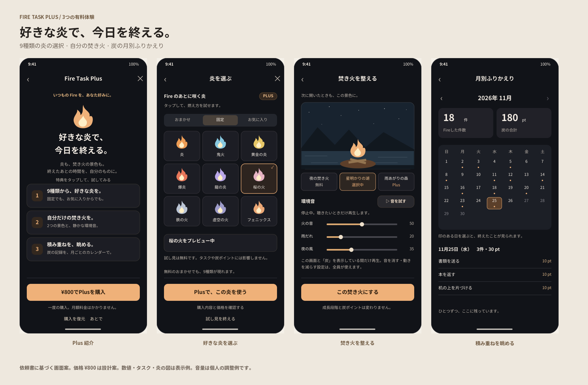

# Fire Task Plus — 設計・実装の入口

更新日：2026年11月27日

初期のPlus実装は [PR #123](https://github.com/sunpotflower4460-cpu/sumples-fire/pull/123) で統合されました。実機Sandbox、商品登録、TestFlightは引き続き提出前の作業です。以下の設計図と引き継ぎ書は初期実装時の資料です。

実装内容と検証結果：[IMPLEMENTATION_NOTES.md](IMPLEMENTATION_NOTES.md) / StoreKitのテスト手順：[STOREKIT_TESTING.md](STOREKIT_TESTING.md)

## 読む順番

1. [IMPLEMENTATION_HANDOFF.md](IMPLEMENTATION_HANDOFF.md) — 先行PRとの関係、現行コードの対応、実装順、検証条件。
2. [DESIGN.md](DESIGN.md) — 無料／Plusの境界、3機能の仕様、価格、全画面文言、購入と復元の分岐。
3. [SCREEN_DESIGN.pdf](SCREEN_DESIGN.pdf) — 4ページの画面モックアップ。
4. [SCREEN_OVERVIEW.png](SCREEN_OVERVIEW.png) — 主要4画面の一覧。

## 推奨する商品

**Fire Task Plus、買い切り1商品、設計価格800円。** 商品登録と実際の表示価格は未確定です。

- 18種類の炎から固定、またはお気に入りから選択。極光の炎、蓮の灯、彗星の炎など9種類はPlus専用。選択画面内で各演出を試し見できる。
- 9種類の景色から焚き火を選び、6種類の環境音を個別に調整して保存。新しい景色6種類に加え、既存の湖と森も描き直した。景色ごとの音量設定と5種類の音の組み合わせから調整を始められる。
- 月別カレンダーと日別一覧を切り替え、Fire件数、炭合計、Fireした日数を確認できる。日付から既存の炭の記録を開ける。

タスクの追加・Fire・Undo・既存の炭記録・成長・称号・9種類の炎の自動出現は無料のまま維持します。購入前の試し見は実タスク・炭・実績を変更しません。

## 提出準備

Plusは提出準備PR [#122](https://github.com/sunpotflower4460-cpu/sumples-fire/pull/122) のiOSネイティブ保存、UIScene、WebKit E2E基盤を利用します。App Store提出時は [提出資料](../APP_STORE_SUBMISSION.md) と [実機チェックリスト](../RELEASE_MANUAL_TEST.md) を参照してください。

## 設計図と現行UIの関係

画面案は導線と有料機能の見せ方を示すもので、現行アプリのスクリーンショットではありません。現行のダーク／ライトテーマ、フォーカス制御、Safe Area、省モーションを維持して実装します。

現在の `FireCampfire` は「今日」、`AshLegacy` は「炭」にあります。「今日」の無料の焚き火を残したまま、「炭」に情景を眺める領域を追加する方針です。PDFと実装上の詳細に差がある場合は、引き継ぎ書と詳細設計の記載を優先します。

## 設計資料の確認範囲（設計追加時）

設計・現行コード・先行PRとの整合、Markdownのリンク、PDF／画像の内容を確認しました。文書のみの変更であり、アプリのビルド・テスト・実機課金は今回実行していません。PR #122に記載された検証結果は、そのPRでの報告であり、今回の再実行結果ではありません。
